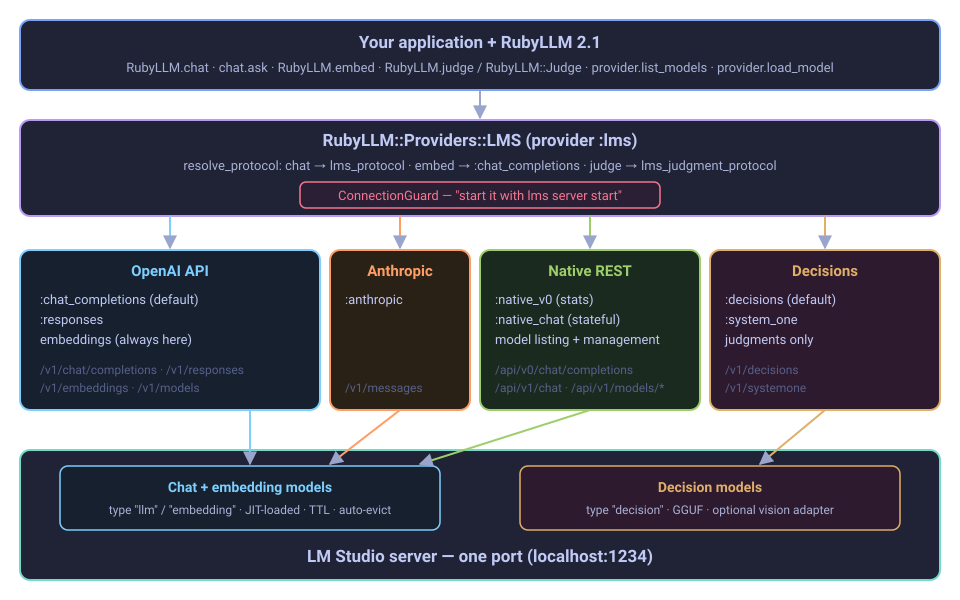
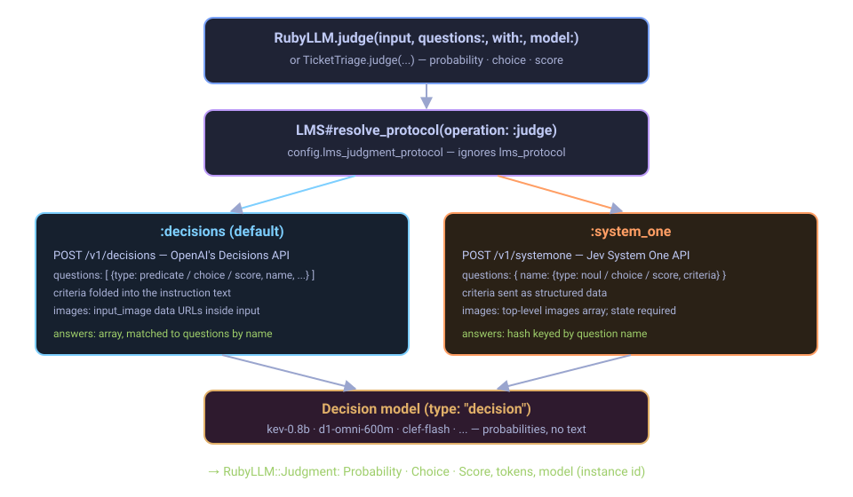

# Architecture

The gem is a single RubyLLM provider class, `RubyLLM::Providers::LMS`, with one
protocol class per LM Studio dialect. RubyLLM does the rest: chats, streaming,
tools, embeddings and judgments all run through RubyLLM's own machinery, and
the provider decides which LM Studio endpoint each one reaches.

{ .diagram }

## Routing

RubyLLM asks the provider to resolve a protocol for every operation. The
provider answers by operation, not just by configuration:

| Operation | Goes to | Chosen by |
| --- | --- | --- |
| chat (`ask`, streaming, tools) | the chat protocol | `lms_protocol`, default `:chat_completions` |
| embed | `:chat_completions` → `POST /v1/embeddings` | always — LM Studio serves embeddings nowhere else |
| judge | `:decisions` or `:system_one` | `lms_judgment_protocol`, default `:decisions` |
| list models | the chat protocol's `list_models`, enriched from the native listing | — |
| load / unload / download | the provider's own `ModelManagement` methods | — |

The judgment route is the provider's private `resolve_protocol` override: when
RubyLLM resolves with `operation: :judge`, it substitutes
`lms_judgment_protocol`. Without it, `lms_protocol = :anthropic` would send
judgments to a protocol that has none.

{ .diagram }

## Source layout

| File | Responsibility |
| --- | --- |
| `lib/ruby_llm/providers/lms.rb` | The provider: protocol registry, API base and auth headers, embedding and judgment routing, configuration options; registers `:lms` with RubyLLM at load time |
| `lms/connection_guard.rb` | Wraps RubyLLM's connection so a refused connection raises a `RubyLLM::Error` telling you to run `lms server start` |
| `lms/models.rb` | Model listing: OpenAI `/v1/models` enriched with native details; capabilities, modalities and metadata |
| `lms/native_v1.rb` | Rewrites the native v1 listing into the shape `models.rb` reads, including reasoning options and decision fields |
| `lms/endpoints.rb` | Native listing paths, spelled relative to the `/v1` base |
| `lms/responses.rb` | `:responses` — reads LM Studio's `reasoning_text` as well as OpenAI's summaries |
| `lms/anthropic_messages.rb` | `:anthropic` — RubyLLM's Anthropic protocol with LM Studio's path |
| `lms/native_chat.rb`, `native_chat/*` | `:native_chat` — stateful `/api/v1/chat`, with conversation continuation and streaming |
| `lms/decisions.rb` | `:decisions` — OpenAI Decisions, answers matched to questions by name |
| `lms/system_one.rb` | `:system_one` — System One with the `/v1`-relative path and image support |
| `lms/model_management.rb` | `native_models`, `loaded_models`, `load_model`, `unload_model`, `download_model` |
| `lms/version.rb` | `RubyLLM::Providers::LMS::VERSION` |

`:chat_completions` and `:native_v0` are small classes defined in `lms.rb`
itself; `:native_v0` is the Chat Completions protocol pointed at
`/api/v0/chat/completions`.

## Design rules

- **Everything lives in `RubyLLM::Providers::LMS`.** The gem adds no top-level
  constants. `Archspec.rb` enforces this, and that nothing under `lib/`
  references RSpec, WebMock or VCR.
- **Subclass RubyLLM, don't fork it.** Each protocol is RubyLLM's stock
  protocol with the smallest override LM Studio needs — a path, a response
  field, a matching rule.
- **Local means no ceremony.** `local?` is true, so RubyLLM needs no API key
  and assumes any model id exists; the auth header is sent only when
  `lms_api_key` is set.
- **Paths are relative to the `/v1` base.** Native endpoints are reached as
  `../api/v1/...` so a non-default `lms_api_base` moves everything together.
